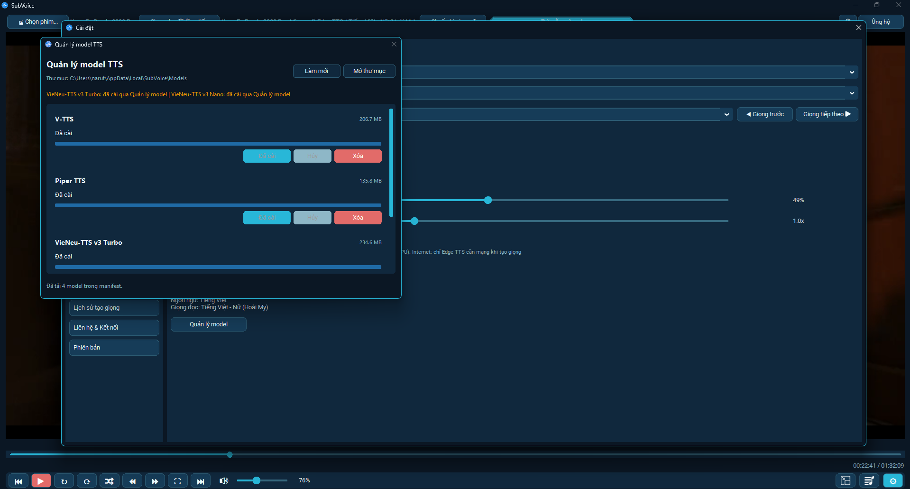
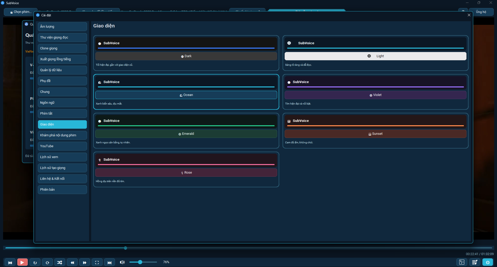
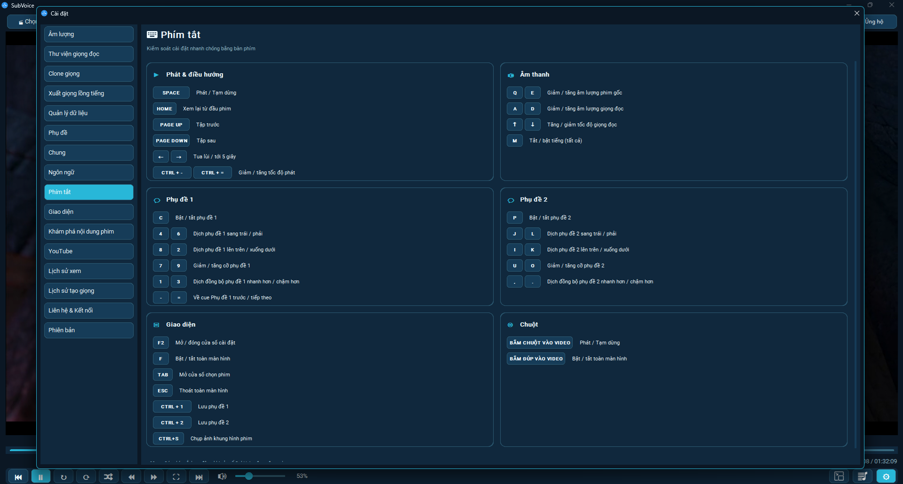
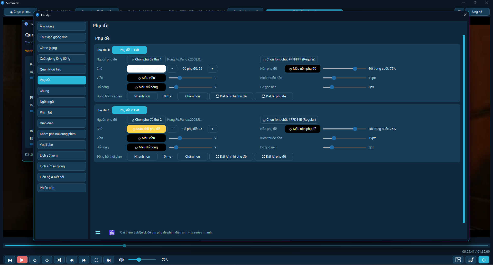
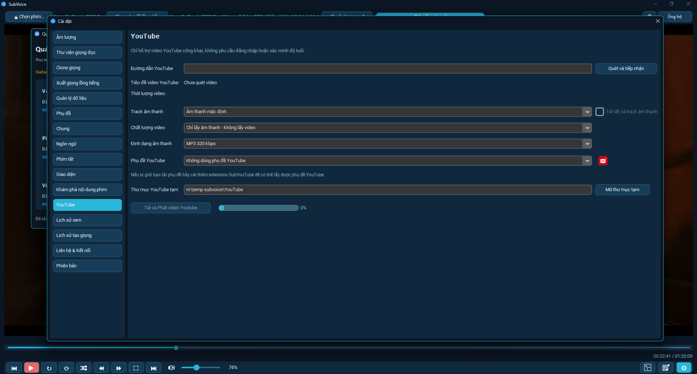
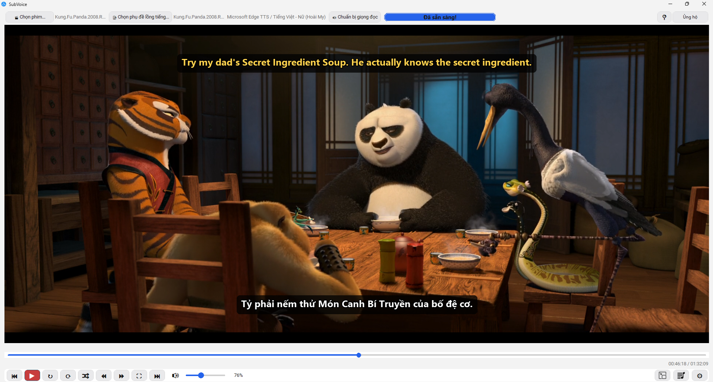

# SubVoice

 

  
  
  
  

  
  
  

  <a href="https://github.com/Tungronoro/SubVoice/releases"><b>⬇️ Tải SubVoice_Setup.exe</b></a>
  &nbsp;•&nbsp;
  <a href="https://www.youtube.com/playlist?list=PLYnMAMqLtnWE"><b>📺 Video Demo</b></a>
  &nbsp;•&nbsp;
  <a href="#tính-năng-chính"><b>✨ Tính năng</b></a>

> 🎧 **SubVoice — Trình phát video & audio đọc phụ đề bằng giọng AI tự nhiên, đồng bộ hoàn hảo với video.**
> *A Windows app that reads subtitles aloud using natural AI voices in perfect sync with video playback.*

SubVoice là phần mềm phát video và audio, có giọng đọc AI và tạo thuyết minh từ phụ đề.

## 📸 Giao diện

  

  
  

  
  

  

## Tải xuống

Tải `SubVoice_Setup.exe` từ trang [Releases](https://github.com/Tungronoro/SubVoice/releases), sau đó chạy file cài đặt và làm theo hướng dẫn.

## Tính năng chính

- Phát video và các file audio phổ biến.
- Hỗ trợ 2 phụ đề, chỉnh vị trí, kích thước, màu sắc và thời gian đồng bộ.
- Giọng đọc AI: VieNeu-TTS có sẵn trong bộ cài; Edge TTS cần kết nối internet.
- Tạo và xuất file MP3 thuyết minh theo timeline phụ đề.
- Phím tắt, toàn màn hình, nhiều giao diện màu sắc.
- Nhớ vị trí xem và lịch sử xem.
- Lịch sử tạo giọng: xem phim nào đã tạo giọng nào, phát lại đúng phim kèm đúng giọng.
- Quản lý dữ liệu trong một thư mục gốc riêng.

## 🎙️ Demo giọng thuyết minh

Nhấn vào cột **Demo** để nhảy tới đúng mốc thời gian của từng giọng trong video.

### Video 1 — Thuyết minh tiếng Việt (Inglourious Basterds, 2009)

[▶ Xem Video 1](https://www.youtube.com/watch?v=CeuPjz_mPtU)

**Edge TTS**

| Giọng | Mốc | Demo |
|---|---|---|
| Edge TTS NamMinh | 0:00 | [▶](https://www.youtube.com/watch?v=CeuPjz_mPtU&t=0) |
| Edge TTS HoaiMy | 5:30 | [▶](https://www.youtube.com/watch?v=CeuPjz_mPtU&t=330) |

**VieNeu Turbo**

| Giọng | Mốc | Demo |
|---|---|---|
| VieNeu Turbo Adam bựa | 11:00 | [▶](https://www.youtube.com/watch?v=CeuPjz_mPtU&t=660) |
| VieNeu Turbo Adam | 16:30 | [▶](https://www.youtube.com/watch?v=CeuPjz_mPtU&t=990) |
| VieNeu Turbo Đoan Trang | 22:00 | [▶](https://www.youtube.com/watch?v=CeuPjz_mPtU&t=1320) |
| VieNeu Turbo Hải Đăng | 27:30 | [▶](https://www.youtube.com/watch?v=CeuPjz_mPtU&t=1650) |
| VieNeu Turbo Kim Thanh | 33:00 | [▶](https://www.youtube.com/watch?v=CeuPjz_mPtU&t=1980) |
| VieNeu Turbo Mai Anh | 38:30 | [▶](https://www.youtube.com/watch?v=CeuPjz_mPtU&t=2310) |
| VieNeu Turbo Minh Triết | 44:00 | [▶](https://www.youtube.com/watch?v=CeuPjz_mPtU&t=2640) |
| VieNeu Turbo Mỹ Duyên | 49:30 | [▶](https://www.youtube.com/watch?v=CeuPjz_mPtU&t=2970) |
| VieNeu Turbo Ngọc Linh | 55:00 | [▶](https://www.youtube.com/watch?v=CeuPjz_mPtU&t=3300) |
| VieNeu Turbo Ngọc Trân | 1:00:30 | [▶](https://www.youtube.com/watch?v=CeuPjz_mPtU&t=3630) |
| VieNeu Turbo Phạm Tuyên | 1:06:00 | [▶](https://www.youtube.com/watch?v=CeuPjz_mPtU&t=3960) |
| VieNeu Turbo Quang Sơn | 1:11:30 | [▶](https://www.youtube.com/watch?v=CeuPjz_mPtU&t=4290) |
| VieNeu Turbo Quốc Tuấn | 1:17:00 | [▶](https://www.youtube.com/watch?v=CeuPjz_mPtU&t=4620) |
| VieNeu Turbo Quỳnh Anh | 1:22:30 | [▶](https://www.youtube.com/watch?v=CeuPjz_mPtU&t=4950) |
| VieNeu Turbo Thái Sơn | 1:28:00 | [▶](https://www.youtube.com/watch?v=CeuPjz_mPtU&t=5280) |
| VieNeu Turbo Thanh Bình | 1:33:30 | [▶](https://www.youtube.com/watch?v=CeuPjz_mPtU&t=5610) |
| VieNeu Turbo Thiện Minh | 1:39:00 | [▶](https://www.youtube.com/watch?v=CeuPjz_mPtU&t=5940) |
| VieNeu Turbo Tâm Đức | 1:44:30 | [▶](https://www.youtube.com/watch?v=CeuPjz_mPtU&t=6270) |
| VieNeu Turbo Thục Đoan | 1:50:00 | [▶](https://www.youtube.com/watch?v=CeuPjz_mPtU&t=6600) |
| VieNeu Turbo Thùy Dung | 1:55:30 | [▶](https://www.youtube.com/watch?v=CeuPjz_mPtU&t=6930) |
| VieNeu Turbo Trúc Ly | 2:01:00 | [▶](https://www.youtube.com/watch?v=CeuPjz_mPtU&t=7260) |
| VieNeu Turbo Xuân Vĩnh | 2:06:30 | [▶](https://www.youtube.com/watch?v=CeuPjz_mPtU&t=7590) |
| VieNeu Turbo Đức Trí | 2:12:00 | [▶](https://www.youtube.com/watch?v=CeuPjz_mPtU&t=7920) |
| VieNeu Turbo Minh Đức | 2:17:30 | [▶](https://www.youtube.com/watch?v=CeuPjz_mPtU&t=8250) |

**VieNeu Nano**

| Giọng | Mốc | Demo |
|---|---|---|
| VieNeu Nano Adam | 2:23:00 | [▶](https://www.youtube.com/watch?v=CeuPjz_mPtU&t=8580) |
| VieNeu Nano Ái Hân | 2:28:30 | [▶](https://www.youtube.com/watch?v=CeuPjz_mPtU&t=8910) |
| VieNeu Nano Anh Khôi | 2:34:00 | [▶](https://www.youtube.com/watch?v=CeuPjz_mPtU&t=9240) |
| VieNeu Nano Đức Trí | 2:39:30 | [▶](https://www.youtube.com/watch?v=CeuPjz_mPtU&t=9570) |
| VieNeu Nano Hữu Quân | 2:45:00 | [▶](https://www.youtube.com/watch?v=CeuPjz_mPtU&t=9900) |
| VieNeu Nano Mai Anh | 2:50:30 | [▶](https://www.youtube.com/watch?v=CeuPjz_mPtU&t=10230) |
| VieNeu Nano Mạnh Dũng | 2:56:00 | [▶](https://www.youtube.com/watch?v=CeuPjz_mPtU&t=10560) |
| VieNeu Nano Minh Quân | 3:01:30 | [▶](https://www.youtube.com/watch?v=CeuPjz_mPtU&t=10890) |
| VieNeu Nano Mỹ Duyên | 3:07:00 | [▶](https://www.youtube.com/watch?v=CeuPjz_mPtU&t=11220) |
| VieNeu Nano Trúc Ly | 3:12:30 | [▶](https://www.youtube.com/watch?v=CeuPjz_mPtU&t=11550) |
| VieNeu Nano Xuân Tiên | 3:18:00 | [▶](https://www.youtube.com/watch?v=CeuPjz_mPtU&t=11880) |

**Piper**

| Giọng | Mốc | Demo |
|---|---|---|
| Piper Single-low | 3:23:30 | [▶](https://www.youtube.com/watch?v=CeuPjz_mPtU&t=12210) |
| Piper Vais1000-medium | 3:29:00 | [▶](https://www.youtube.com/watch?v=CeuPjz_mPtU&t=12540) |
| Piper Vivos-x_low_0 | 3:34:30 | [▶](https://www.youtube.com/watch?v=CeuPjz_mPtU&t=12870) |

**Vtts**

| Giọng | Mốc | Demo |
|---|---|---|
| Vtts NF | 3:40:00 | [▶](https://www.youtube.com/watch?v=CeuPjz_mPtU&t=13200) |
| Vtts NM1 | 3:45:30 | [▶](https://www.youtube.com/watch?v=CeuPjz_mPtU&t=13530) |
| Vtts NM2 | 3:51:00 | [▶](https://www.youtube.com/watch?v=CeuPjz_mPtU&t=13860) |
| Vtts SF | 3:56:30 | [▶](https://www.youtube.com/watch?v=CeuPjz_mPtU&t=14190) |
| Vtts SM | 4:02:00 | [▶](https://www.youtube.com/watch?v=CeuPjz_mPtU&t=14520) |

### Video 2 — Thuyết minh tiếng nước ngoài (Inglourious Basterds, 2009)

[▶ Xem Video 2](https://www.youtube.com/watch?v=abLxefxIyZw)

**Tiếng Đức**

| Giọng | Mốc | Demo |
|---|---|---|
| Tiếng Đức - Nam (Conrad) | 0:00 | [▶](https://www.youtube.com/watch?v=abLxefxIyZw&t=0) |
| Tiếng Đức - Nữ (Katja) | 5:30 | [▶](https://www.youtube.com/watch?v=abLxefxIyZw&t=330) |

**Tiếng Tây Ban Nha**

| Giọng | Mốc | Demo |
|---|---|---|
| Tiếng Tây Ban Nha - Nam (Alvaro) | 11:00 | [▶](https://www.youtube.com/watch?v=abLxefxIyZw&t=660) |
| Tiếng Tây Ban Nha - Nữ (Elvira) | 16:30 | [▶](https://www.youtube.com/watch?v=abLxefxIyZw&t=990) |

**Tiếng Pháp**

| Giọng | Mốc | Demo |
|---|---|---|
| Tiếng Pháp - Nam (Henri) | 22:00 | [▶](https://www.youtube.com/watch?v=abLxefxIyZw&t=1320) |
| Tiếng Pháp - Nữ (Denise) | 27:30 | [▶](https://www.youtube.com/watch?v=abLxefxIyZw&t=1650) |

**Tiếng Anh**

| Giọng | Mốc | Demo |
|---|---|---|
| Tiếng Anh - Nam (Guy) | 33:00 | [▶](https://www.youtube.com/watch?v=abLxefxIyZw&t=1980) |
| Tiếng Anh - Nữ (Aria) | 38:30 | [▶](https://www.youtube.com/watch?v=abLxefxIyZw&t=2310) |

**Tiếng Anh Anh**

| Giọng | Mốc | Demo |
|---|---|---|
| Tiếng Anh Anh - Nữ (Sonia) | 44:00 | [▶](https://www.youtube.com/watch?v=abLxefxIyZw&t=2640) |

**Tiếng Nhật Bản**

| Giọng | Mốc | Demo |
|---|---|---|
| Tiếng Nhật Bản - Nam (Keita) | 49:30 | [▶](https://www.youtube.com/watch?v=abLxefxIyZw&t=2970) |
| Tiếng Nhật Bản - Nữ (Nanami) | 55:00 | [▶](https://www.youtube.com/watch?v=abLxefxIyZw&t=3300) |

**Tiếng Trung (Đài Loan)**

| Giọng | Mốc | Demo |
|---|---|---|
| Tiếng Trung (Đài Loan) - Nữ (HsiaoChen) | 1:00:30 | [▶](https://www.youtube.com/watch?v=abLxefxIyZw&t=3630) |

**Tiếng Trung Quốc**

| Giọng | Mốc | Demo |
|---|---|---|
| Tiếng Trung Quốc - Nam (Yunxi) | 1:06:00 | [▶](https://www.youtube.com/watch?v=abLxefxIyZw&t=3960) |
| Tiếng Trung Quốc - Nữ (Xiaoxiao) | 1:11:30 | [▶](https://www.youtube.com/watch?v=abLxefxIyZw&t=4290) |

**Tiếng Hàn Quốc**

| Giọng | Mốc | Demo |
|---|---|---|
| Tiếng Hàn Quốc - Nam (InJoon) | 1:17:00 | [▶](https://www.youtube.com/watch?v=abLxefxIyZw&t=4620) |
| Tiếng Hàn Quốc - Nữ (SunHi) | 1:22:30 | [▶](https://www.youtube.com/watch?v=abLxefxIyZw&t=4950) |

## Sử dụng nhanh

1. Mở video hoặc audio.
2. Chọn phụ đề trong **Cài đặt**.
3. Chọn giọng đọc và tạo thuyết minh.
4. Xuất MP3 nếu cần.

Dữ liệu người dùng được lưu ở thư mục gốc dữ liệu riêng. Xem đường dẫn trong **Cài đặt → Quản lý dữ liệu**.

---

# English

## SubVoice

SubVoice is a video and audio player with AI voice narration and subtitle-based dubbed audio.

## 📸 Screenshots

  

  
  

  
  

  

## Download

Download `SubVoice_Setup.exe` from the [Releases](https://github.com/Tungronoro/SubVoice/releases) page, then run the installer and follow the instructions.

## Main features

- Play common video and audio files.
- Support 2 subtitles with adjustable position, size, color, and timing.
- AI voices: VieNeu-TTS is bundled; Edge TTS requires internet.
- Generate and export dubbed MP3 files based on the subtitle timeline.
- Keyboard shortcuts, full-screen mode, and multiple color themes.
- Remember playback position and viewing history.
- Voice history: see which movie used which voice and replay the exact combination.
- Manage all app data in one separate data folder.

## 🎙️ Voice Demos

Click the **Demo** column to jump to the exact timecode of each voice.

### Video 1 — Vietnamese narration (Inglourious Basterds, 2009)

[▶ Watch Video 1](https://www.youtube.com/watch?v=CeuPjz_mPtU)

**Edge TTS**

| Voice | Time | Demo |
|---|---|---|
| Edge TTS NamMinh | 0:00 | [▶](https://www.youtube.com/watch?v=CeuPjz_mPtU&t=0) |
| Edge TTS HoaiMy | 5:30 | [▶](https://www.youtube.com/watch?v=CeuPjz_mPtU&t=330) |

**VieNeu Turbo**

| Voice | Time | Demo |
|---|---|---|
| VieNeu Turbo Adam bựa | 11:00 | [▶](https://www.youtube.com/watch?v=CeuPjz_mPtU&t=660) |
| VieNeu Turbo Adam | 16:30 | [▶](https://www.youtube.com/watch?v=CeuPjz_mPtU&t=990) |
| VieNeu Turbo Đoan Trang | 22:00 | [▶](https://www.youtube.com/watch?v=CeuPjz_mPtU&t=1320) |
| VieNeu Turbo Hải Đăng | 27:30 | [▶](https://www.youtube.com/watch?v=CeuPjz_mPtU&t=1650) |
| VieNeu Turbo Kim Thanh | 33:00 | [▶](https://www.youtube.com/watch?v=CeuPjz_mPtU&t=1980) |
| VieNeu Turbo Mai Anh | 38:30 | [▶](https://www.youtube.com/watch?v=CeuPjz_mPtU&t=2310) |
| VieNeu Turbo Minh Triết | 44:00 | [▶](https://www.youtube.com/watch?v=CeuPjz_mPtU&t=2640) |
| VieNeu Turbo Mỹ Duyên | 49:30 | [▶](https://www.youtube.com/watch?v=CeuPjz_mPtU&t=2970) |
| VieNeu Turbo Ngọc Linh | 55:00 | [▶](https://www.youtube.com/watch?v=CeuPjz_mPtU&t=3300) |
| VieNeu Turbo Ngọc Trân | 1:00:30 | [▶](https://www.youtube.com/watch?v=CeuPjz_mPtU&t=3630) |
| VieNeu Turbo Phạm Tuyên | 1:06:00 | [▶](https://www.youtube.com/watch?v=CeuPjz_mPtU&t=3960) |
| VieNeu Turbo Quang Sơn | 1:11:30 | [▶](https://www.youtube.com/watch?v=CeuPjz_mPtU&t=4290) |
| VieNeu Turbo Quốc Tuấn | 1:17:00 | [▶](https://www.youtube.com/watch?v=CeuPjz_mPtU&t=4620) |
| VieNeu Turbo Quỳnh Anh | 1:22:30 | [▶](https://www.youtube.com/watch?v=CeuPjz_mPtU&t=4950) |
| VieNeu Turbo Thái Sơn | 1:28:00 | [▶](https://www.youtube.com/watch?v=CeuPjz_mPtU&t=5280) |
| VieNeu Turbo Thanh Bình | 1:33:30 | [▶](https://www.youtube.com/watch?v=CeuPjz_mPtU&t=5610) |
| VieNeu Turbo Thiện Minh | 1:39:00 | [▶](https://www.youtube.com/watch?v=CeuPjz_mPtU&t=5940) |
| VieNeu Turbo Tâm Đức | 1:44:30 | [▶](https://www.youtube.com/watch?v=CeuPjz_mPtU&t=6270) |
| VieNeu Turbo Thục Đoan | 1:50:00 | [▶](https://www.youtube.com/watch?v=CeuPjz_mPtU&t=6600) |
| VieNeu Turbo Thùy Dung | 1:55:30 | [▶](https://www.youtube.com/watch?v=CeuPjz_mPtU&t=6930) |
| VieNeu Turbo Trúc Ly | 2:01:00 | [▶](https://www.youtube.com/watch?v=CeuPjz_mPtU&t=7260) |
| VieNeu Turbo Xuân Vĩnh | 2:06:30 | [▶](https://www.youtube.com/watch?v=CeuPjz_mPtU&t=7590) |
| VieNeu Turbo Đức Trí | 2:12:00 | [▶](https://www.youtube.com/watch?v=CeuPjz_mPtU&t=7920) |
| VieNeu Turbo Minh Đức | 2:17:30 | [▶](https://www.youtube.com/watch?v=CeuPjz_mPtU&t=8250) |

**VieNeu Nano**

| Voice | Time | Demo |
|---|---|---|
| VieNeu Nano Adam | 2:23:00 | [▶](https://www.youtube.com/watch?v=CeuPjz_mPtU&t=8580) |
| VieNeu Nano Ái Hân | 2:28:30 | [▶](https://www.youtube.com/watch?v=CeuPjz_mPtU&t=8910) |
| VieNeu Nano Anh Khôi | 2:34:00 | [▶](https://www.youtube.com/watch?v=CeuPjz_mPtU&t=9240) |
| VieNeu Nano Đức Trí | 2:39:30 | [▶](https://www.youtube.com/watch?v=CeuPjz_mPtU&t=9570) |
| VieNeu Nano Hữu Quân | 2:45:00 | [▶](https://www.youtube.com/watch?v=CeuPjz_mPtU&t=9900) |
| VieNeu Nano Mai Anh | 2:50:30 | [▶](https://www.youtube.com/watch?v=CeuPjz_mPtU&t=10230) |
| VieNeu Nano Mạnh Dũng | 2:56:00 | [▶](https://www.youtube.com/watch?v=CeuPjz_mPtU&t=10560) |
| VieNeu Nano Minh Quân | 3:01:30 | [▶](https://www.youtube.com/watch?v=CeuPjz_mPtU&t=10890) |
| VieNeu Nano Mỹ Duyên | 3:07:00 | [▶](https://www.youtube.com/watch?v=CeuPjz_mPtU&t=11220) |
| VieNeu Nano Trúc Ly | 3:12:30 | [▶](https://www.youtube.com/watch?v=CeuPjz_mPtU&t=11550) |
| VieNeu Nano Xuân Tiên | 3:18:00 | [▶](https://www.youtube.com/watch?v=CeuPjz_mPtU&t=11880) |

**Piper**

| Voice | Time | Demo |
|---|---|---|
| Piper Single-low | 3:23:30 | [▶](https://www.youtube.com/watch?v=CeuPjz_mPtU&t=12210) |
| Piper Vais1000-medium | 3:29:00 | [▶](https://www.youtube.com/watch?v=CeuPjz_mPtU&t=12540) |
| Piper Vivos-x_low_0 | 3:34:30 | [▶](https://www.youtube.com/watch?v=CeuPjz_mPtU&t=12870) |

**Vtts**

| Voice | Time | Demo |
|---|---|---|
| Vtts NF | 3:40:00 | [▶](https://www.youtube.com/watch?v=CeuPjz_mPtU&t=13200) |
| Vtts NM1 | 3:45:30 | [▶](https://www.youtube.com/watch?v=CeuPjz_mPtU&t=13530) |
| Vtts NM2 | 3:51:00 | [▶](https://www.youtube.com/watch?v=CeuPjz_mPtU&t=13860) |
| Vtts SF | 3:56:30 | [▶](https://www.youtube.com/watch?v=CeuPjz_mPtU&t=14190) |
| Vtts SM | 4:02:00 | [▶](https://www.youtube.com/watch?v=CeuPjz_mPtU&t=14520) |

### Video 2 — Foreign-language commentary (Inglourious Basterds, 2009)

[▶ Watch Video 2](https://www.youtube.com/watch?v=abLxefxIyZw)

**Tiếng Đức**

| Voice | Time | Demo |
|---|---|---|
| Tiếng Đức - Nam (Conrad) | 0:00 | [▶](https://www.youtube.com/watch?v=abLxefxIyZw&t=0) |
| Tiếng Đức - Nữ (Katja) | 5:30 | [▶](https://www.youtube.com/watch?v=abLxefxIyZw&t=330) |

**Tiếng Tây Ban Nha**

| Voice | Time | Demo |
|---|---|---|
| Tiếng Tây Ban Nha - Nam (Alvaro) | 11:00 | [▶](https://www.youtube.com/watch?v=abLxefxIyZw&t=660) |
| Tiếng Tây Ban Nha - Nữ (Elvira) | 16:30 | [▶](https://www.youtube.com/watch?v=abLxefxIyZw&t=990) |

**Tiếng Pháp**

| Voice | Time | Demo |
|---|---|---|
| Tiếng Pháp - Nam (Henri) | 22:00 | [▶](https://www.youtube.com/watch?v=abLxefxIyZw&t=1320) |
| Tiếng Pháp - Nữ (Denise) | 27:30 | [▶](https://www.youtube.com/watch?v=abLxefxIyZw&t=1650) |

**Tiếng Anh**

| Voice | Time | Demo |
|---|---|---|
| Tiếng Anh - Nam (Guy) | 33:00 | [▶](https://www.youtube.com/watch?v=abLxefxIyZw&t=1980) |
| Tiếng Anh - Nữ (Aria) | 38:30 | [▶](https://www.youtube.com/watch?v=abLxefxIyZw&t=2310) |

**Tiếng Anh Anh**

| Voice | Time | Demo |
|---|---|---|
| Tiếng Anh Anh - Nữ (Sonia) | 44:00 | [▶](https://www.youtube.com/watch?v=abLxefxIyZw&t=2640) |

**Tiếng Nhật Bản**

| Voice | Time | Demo |
|---|---|---|
| Tiếng Nhật Bản - Nam (Keita) | 49:30 | [▶](https://www.youtube.com/watch?v=abLxefxIyZw&t=2970) |
| Tiếng Nhật Bản - Nữ (Nanami) | 55:00 | [▶](https://www.youtube.com/watch?v=abLxefxIyZw&t=3300) |

**Tiếng Trung (Đài Loan)**

| Voice | Time | Demo |
|---|---|---|
| Tiếng Trung (Đài Loan) - Nữ (HsiaoChen) | 1:00:30 | [▶](https://www.youtube.com/watch?v=abLxefxIyZw&t=3630) |

**Tiếng Trung Quốc**

| Voice | Time | Demo |
|---|---|---|
| Tiếng Trung Quốc - Nam (Yunxi) | 1:06:00 | [▶](https://www.youtube.com/watch?v=abLxefxIyZw&t=3960) |
| Tiếng Trung Quốc - Nữ (Xiaoxiao) | 1:11:30 | [▶](https://www.youtube.com/watch?v=abLxefxIyZw&t=4290) |

**Tiếng Hàn Quốc**

| Voice | Time | Demo |
|---|---|---|
| Tiếng Hàn Quốc - Nam (InJoon) | 1:17:00 | [▶](https://www.youtube.com/watch?v=abLxefxIyZw&t=4620) |
| Tiếng Hàn Quốc - Nữ (SunHi) | 1:22:30 | [▶](https://www.youtube.com/watch?v=abLxefxIyZw&t=4950) |

## Quick start

1. Open a video or audio file.
2. Select subtitles in **Settings**.
3. Choose a voice and generate narration.
4. Export MP3 if needed.

User data is stored in a separate data folder. See the path in **Settings → Data Management**.
