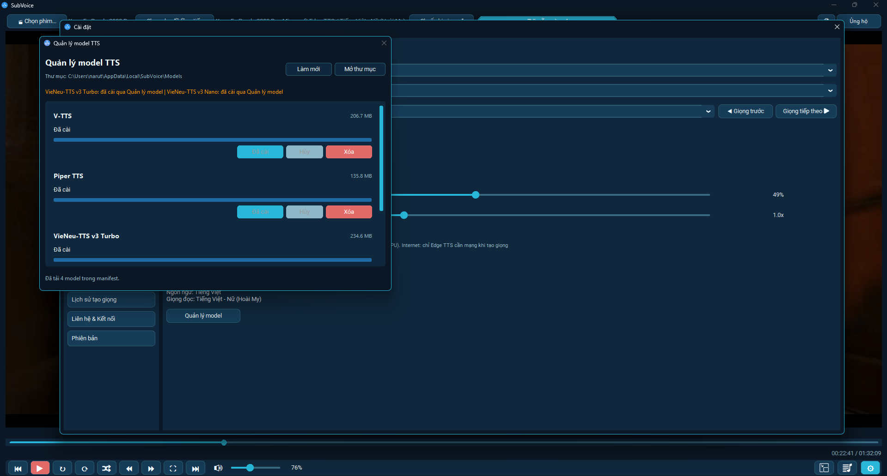
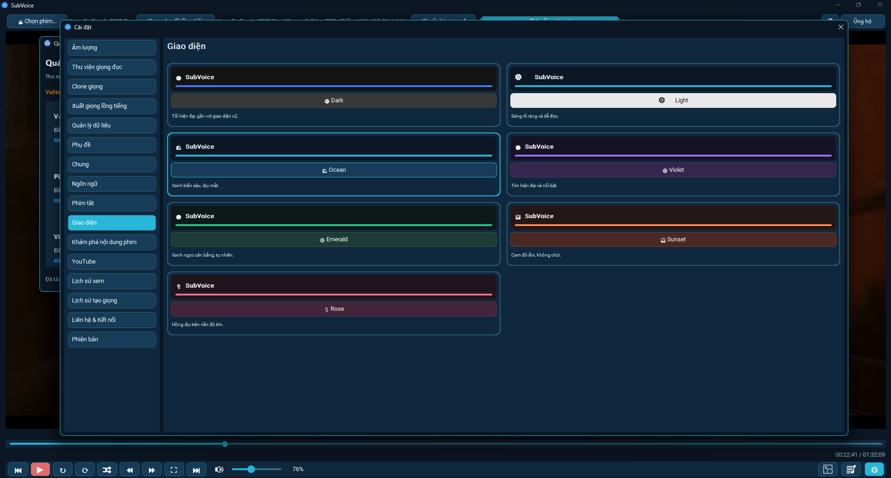
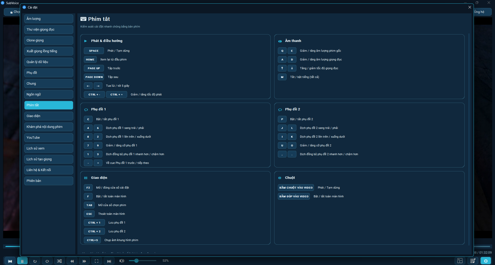
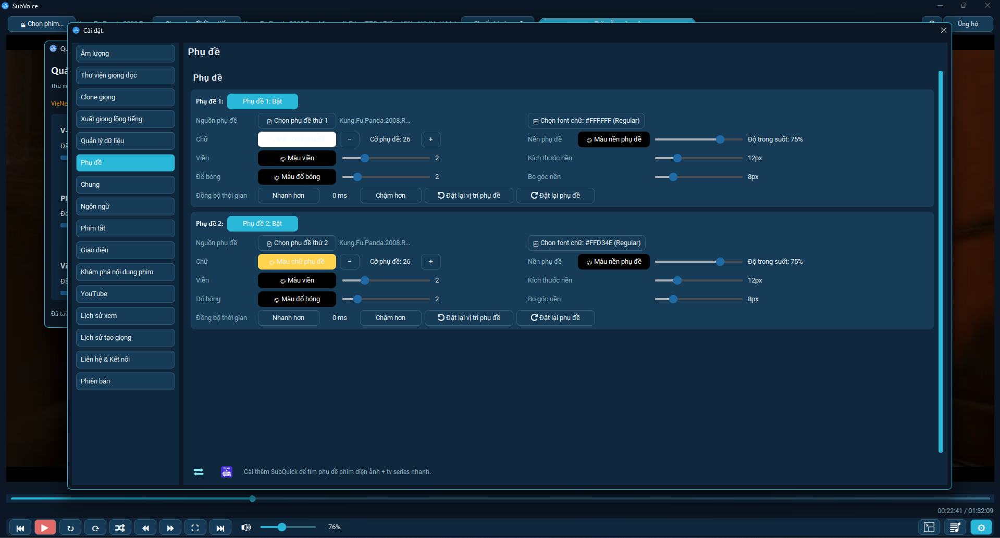
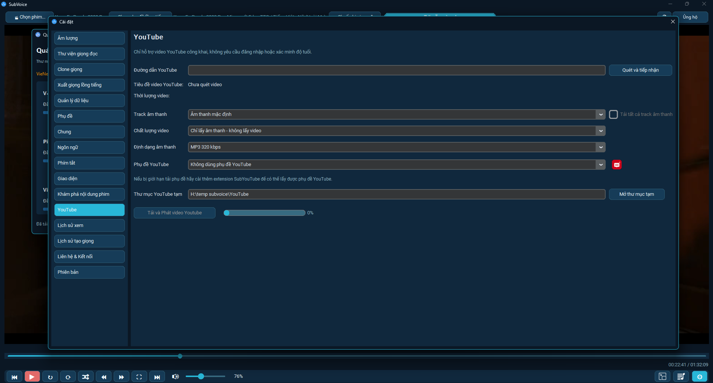
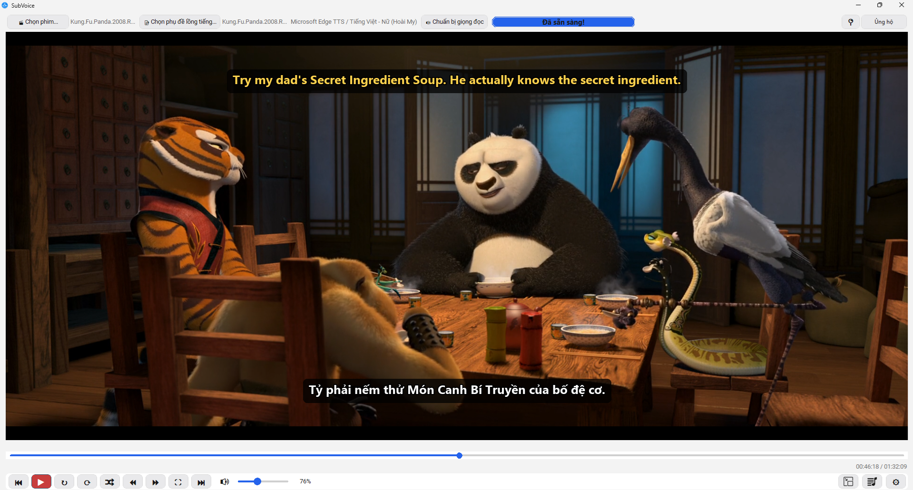

# SubVoice

 

  
  
  
  

  
  
  

  <a href="https://github.com/Tungronoro/SubVoice/releases"><b>⬇️ Tải SubVoice_Setup.exe</b></a>
  &nbsp;•&nbsp;
  <a href="https://www.youtube.com/playlist?list=PLYnMAMqLtnWE"><b>📺 Video Demo</b></a>
  &nbsp;•&nbsp;
  <a href="#tính-năng-chính"><b>✨ Tính năng</b></a>

> 🎧 **SubVoice — Trình phát video & audio đọc phụ đề bằng giọng AI tự nhiên, đồng bộ hoàn hảo với video.**
> *A Windows app that reads subtitles aloud using natural AI voices in perfect sync with video playback.*

SubVoice là phần mềm phát video và audio, có giọng đọc AI và tạo thuyết minh từ phụ đề.

## Giao diện phần mềm

<table>
  <tr>
    <td></td>
    <td></td>
    <td></td>
  </tr>
  <tr>
    <td></td>
    <td></td>
    <td></td>
  </tr>
</table>

## Tải xuống

Tải `SubVoice_Setup.exe` từ trang [Releases](https://github.com/Tungronoro/SubVoice/releases), sau đó chạy file cài đặt và làm theo hướng dẫn.

## Tính năng chính

- Phát video và các file audio phổ biến.
- Hỗ trợ 2 phụ đề, chỉnh vị trí, kích thước, màu sắc và thời gian đồng bộ.
- Giọng đọc AI: VieNeu-TTS có sẵn trong bộ cài; Edge TTS cần kết nối internet.
- Tạo và xuất file MP3 thuyết minh theo timeline phụ đề.
- Phím tắt, toàn màn hình, nhiều giao diện màu sắc.
- Nhớ vị trí xem và lịch sử xem.
- Lịch sử tạo giọng: xem phim nào đã tạo giọng nào, phát lại đúng phim kèm đúng giọng.
- Quản lý dữ liệu trong một thư mục gốc riêng.

## Sử dụng nhanh

1. Mở video hoặc audio.
2. Chọn phụ đề trong **Cài đặt**.
3. Chọn giọng đọc và tạo thuyết minh.
4. Xuất MP3 nếu cần.

Dữ liệu người dùng được lưu ở thư mục gốc dữ liệu riêng. Xem đường dẫn trong **Cài đặt → Quản lý dữ liệu**.

## Video demo

| Video | Link |
|-------|------|
| [Thuyết Minh Tiếng Việt Demo](https://www.youtube.com/watch?v=CeuPjz_mPtU&t) | [YouTube](https://www.youtube.com/watch?v=CeuPjz_mPtU&t) |
| [Thuyết Minh Tiếng Nước Ngoài Demo](https://www.youtube.com/watch?v=abLxefxIyZw&t) | [YouTube](https://www.youtube.com/watch?v=abLxefxIyZw&t) |

### Thuyết Minh Tiếng Việt Demo

| Giọng |
|-------|
| [Edge TTS NamMinh](https://www.youtube.com/watch?v=CeuPjz_mPtU&t=0s) |
| [Edge TTS HoaiMy](https://www.youtube.com/watch?v=CeuPjz_mPtU&t=330s) |
| [VieNeu Turbo Adam bựa](https://www.youtube.com/watch?v=CeuPjz_mPtU&t=660s) |
| [VieNeu Turbo Adam](https://www.youtube.com/watch?v=CeuPjz_mPtU&t=990s) |
| [VieNeu Turbo Đoan Trang](https://www.youtube.com/watch?v=CeuPjz_mPtU&t=1320s) |
| [VieNeu Turbo Hải Đăng](https://www.youtube.com/watch?v=CeuPjz_mPtU&t=1650s) |
| [VieNeu Turbo Kim Thanh](https://www.youtube.com/watch?v=CeuPjz_mPtU&t=1980s) |
| [VieNeu Turbo Mai Anh](https://www.youtube.com/watch?v=CeuPjz_mPtU&t=2310s) |
| [VieNeu Turbo Minh Triết](https://www.youtube.com/watch?v=CeuPjz_mPtU&t=2640s) |
| [VieNeu Turbo Mỹ Duyên](https://www.youtube.com/watch?v=CeuPjz_mPtU&t=2970s) |
| [VieNeu Turbo Ngọc Linh](https://www.youtube.com/watch?v=CeuPjz_mPtU&t=3300s) |
| [VieNeu Turbo Ngọc Trân](https://www.youtube.com/watch?v=CeuPjz_mPtU&t=3630s) |
| [VieNeu Turbo Phạm Tuyên](https://www.youtube.com/watch?v=CeuPjz_mPtU&t=3960s) |
| [VieNeu Turbo Quang Sơn](https://www.youtube.com/watch?v=CeuPjz_mPtU&t=4290s) |
| [VieNeu Turbo Quốc Tuấn](https://www.youtube.com/watch?v=CeuPjz_mPtU&t=4620s) |
| [VieNeu Turbo Quỳnh Anh](https://www.youtube.com/watch?v=CeuPjz_mPtU&t=4950s) |
| [VieNeu Turbo Thái Sơn](https://www.youtube.com/watch?v=CeuPjz_mPtU&t=5280s) |
| [VieNeu Turbo Thanh Bình](https://www.youtube.com/watch?v=CeuPjz_mPtU&t=5610s) |
| [VieNeu Turbo Thiện Minh](https://www.youtube.com/watch?v=CeuPjz_mPtU&t=5940s) |
| [VieNeu Turbo Tâm Đức](https://www.youtube.com/watch?v=CeuPjz_mPtU&t=6270s) |
| [VieNeu Turbo Thục Đoan](https://www.youtube.com/watch?v=CeuPjz_mPtU&t=6600s) |
| [VieNeu Turbo Thùy Dung](https://www.youtube.com/watch?v=CeuPjz_mPtU&t=6930s) |
| [VieNeu Turbo Trúc Ly](https://www.youtube.com/watch?v=CeuPjz_mPtU&t=7260s) |
| [VieNeu Turbo Xuân Vĩnh](https://www.youtube.com/watch?v=CeuPjz_mPtU&t=7590s) |
| [VieNeu Turbo Đức Trí](https://www.youtube.com/watch?v=CeuPjz_mPtU&t=7920s) |
| [VieNeu Turbo Minh Đức](https://www.youtube.com/watch?v=CeuPjz_mPtU&t=8250s) |
| [VieNeu Nano Adam](https://www.youtube.com/watch?v=CeuPjz_mPtU&t=8580s) |
| [VieNeu Nano Ái Hân](https://www.youtube.com/watch?v=CeuPjz_mPtU&t=8910s) |
| [VieNeu Nano Anh Khôi](https://www.youtube.com/watch?v=CeuPjz_mPtU&t=9240s) |
| [VieNeu Nano Đức Trí](https://www.youtube.com/watch?v=CeuPjz_mPtU&t=9570s) |
| [VieNeu Nano Hữu Quân](https://www.youtube.com/watch?v=CeuPjz_mPtU&t=9900s) |
| [VieNeu Nano Mai Anh](https://www.youtube.com/watch?v=CeuPjz_mPtU&t=10230s) |
| [VieNeu Nano Mạnh Dũng](https://www.youtube.com/watch?v=CeuPjz_mPtU&t=10560s) |
| [VieNeu Nano Minh Quân](https://www.youtube.com/watch?v=CeuPjz_mPtU&t=10890s) |
| [VieNeu Nano Mỹ Duyên](https://www.youtube.com/watch?v=CeuPjz_mPtU&t=11220s) |
| [VieNeu Nano Trúc Ly](https://www.youtube.com/watch?v=CeuPjz_mPtU&t=11550s) |
| [VieNeu Nano Xuân Tiên](https://www.youtube.com/watch?v=CeuPjz_mPtU&t=11880s) |
| [Piper Single-low](https://www.youtube.com/watch?v=CeuPjz_mPtU&t=12210s) |
| [Piper Vais1000-medium](https://www.youtube.com/watch?v=CeuPjz_mPtU&t=12540s) |
| [Piper Vivos-x_low_0](https://www.youtube.com/watch?v=CeuPjz_mPtU&t=12870s) |
| [Vtts NF](https://www.youtube.com/watch?v=CeuPjz_mPtU&t=13200s) |
| [Vtts NM1](https://www.youtube.com/watch?v=CeuPjz_mPtU&t=13530s) |
| [Vtts NM2](https://www.youtube.com/watch?v=CeuPjz_mPtU&t=13860s) |
| [Vtts SF](https://www.youtube.com/watch?v=CeuPjz_mPtU&t=14190s) |
| [Vtts SM](https://www.youtube.com/watch?v=CeuPjz_mPtU&t=14520s) |

### Thuyết Minh Tiếng Nước Ngoài Demo

| Giọng |
|-------|
| [Tiếng Đức - Nam (Conrad)](https://www.youtube.com/watch?v=abLxefxIyZw&t=0s) |
| [Tiếng Đức - Nữ (Katja)](https://www.youtube.com/watch?v=abLxefxIyZw&t=330s) |
| [Tiếng Tây Ban Nha - Nam (Alvaro)](https://www.youtube.com/watch?v=abLxefxIyZw&t=660s) |
| [Tiếng Tây Ban Nha - Nữ (Elvira)](https://www.youtube.com/watch?v=abLxefxIyZw&t=990s) |
| [Tiếng Pháp - Nam (Henri)](https://www.youtube.com/watch?v=abLxefxIyZw&t=1320s) |
| [Tiếng Pháp - Nữ (Denise)](https://www.youtube.com/watch?v=abLxefxIyZw&t=1650s) |
| [Tiếng Anh - Nam (Guy)](https://www.youtube.com/watch?v=abLxefxIyZw&t=1980s) |
| [Tiếng Anh - Nữ (Aria)](https://www.youtube.com/watch?v=abLxefxIyZw&t=2310s) |
| [Tiếng Anh Anh - Nữ (Sonia)](https://www.youtube.com/watch?v=abLxefxIyZw&t=2640s) |
| [Tiếng Nhật Bản - Nam (Keita)](https://www.youtube.com/watch?v=abLxefxIyZw&t=2970s) |
| [Tiếng Nhật Bản - Nữ (Nanami)](https://www.youtube.com/watch?v=abLxefxIyZw&t=3300s) |
| [Tiếng Trung (Đài Loan) - Nữ (HsiaoChen)](https://www.youtube.com/watch?v=abLxefxIyZw&t=3630s) |
| [Tiếng Trung Quốc - Nam (Yunxi)](https://www.youtube.com/watch?v=abLxefxIyZw&t=3960s) |
| [Tiếng Trung Quốc - Nữ (Xiaoxiao)](https://www.youtube.com/watch?v=abLxefxIyZw&t=4290s) |
| [Tiếng Hàn Quốc - Nam (InJoon)](https://www.youtube.com/watch?v=abLxefxIyZw&t=4620s) |
| [Tiếng Hàn Quốc - Nữ (SunHi)](https://www.youtube.com/watch?v=abLxefxIyZw&t=4950s) |

---

# English

## SubVoice

SubVoice is a video and audio player with AI voice narration and subtitle-based dubbed audio.

## Download

Download `SubVoice_Setup.exe` from the [Releases](https://github.com/Tungronoro/SubVoice/releases) page, then run the installer and follow the instructions.

## Main features

- Play common video and audio files.
- Support 2 subtitles with adjustable position, size, color, and timing.
- AI voices: VieNeu-TTS is bundled; Edge TTS requires internet.
- Generate and export dubbed MP3 files based on the subtitle timeline.
- Keyboard shortcuts, full-screen mode, and multiple color themes.
- Remember playback position and viewing history.
- Voice history: see which movie used which voice and replay the exact combination.
- Manage all app data in one separate data folder.

## Quick start

1. Open a video or audio file.
2. Select subtitles in **Settings**.
3. Choose a voice and generate narration.
4. Export MP3 if needed.

User data is stored in a separate data folder. See the path in **Settings → Data Management**.

## Demo videos

| Video | Link |
|-------|------|
| [Vietnamese Dubbing Demo](https://www.youtube.com/watch?v=CeuPjz_mPtU&t) | [YouTube](https://www.youtube.com/watch?v=CeuPjz_mPtU&t) |
| [Foreign Languages Dubbing Demo](https://www.youtube.com/watch?v=abLxefxIyZw&t) | [YouTube](https://www.youtube.com/watch?v=abLxefxIyZw&t) |
